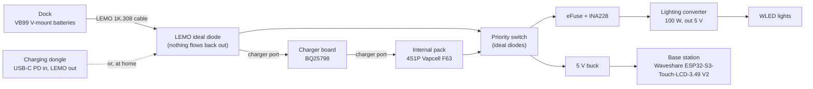
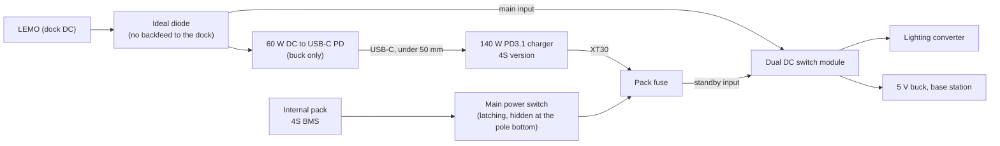

# Power system

Design for Nibbles' power: the internal battery in the pole base, the custom
power board, and the external battery dock. Status: **design agreed, no
hardware built yet.** First-draft KiCad projects with JLCPCB parts and
footprints, roughly placed: the [power board](../hardware/power_board/README.md)
and the [charger board](../hardware/charger_board/README.md) that plugs into
it (the INA228 had no JLCPCB stock; the board uses the pin-compatible
INA226). Part choices are the current plan and still need
datasheet verification before layout. Numbers marked *estimate* should be
replaced with measurements once hardware exists.

## Goals

- The totem runs fully untethered on its internal pack (dancing in a crowd,
  no cable).
- Between sets or when moving between stages, a cable from a backpack dock
  plugs in to run the lights and recharge the internal pack at the same time.
- Plugging and unplugging never makes the lights flicker or reboot anything.
- At home or in a hotel, everything charges over USB-C PD, through a small
  USB-C to LEMO charging dongle. The totem's only power input is the LEMO.
- Every battery that travels stays under 100 Wh (airline carry-on limit).

## System overview

Five pieces of hardware:

| Piece | What it is | Code |
| --- | --- | --- |
| Base station | Existing Waveshare ESP32-S3-Touch-LCD-3.49 **V2** (screen, touch, main brain) | `firmware/base/` |
| Power board | New custom PCB in the pole base, next to the internal pack | none (read over I2C by the base) |
| Charger board | Small custom PCB (BQ25798) on the power board's charger port; swappable for plan B's modules | none (read over I2C by the base) |
| Dock | New small PCB in a backpack enclosure holding VB99 batteries, with an ESP32-C3 | `firmware/dock/` (new) |
| Charging dongle | Small USB-C PD sink (CH224K) with a LEMO plug, for charging without the dock | none |

The Waveshare board stays as a display module for this iteration. A fully
integrated board (bare 172×640 AXS15231B panel on a custom PCB with an
ESP32-S3-WROOM-1-N16R8) is a possible later step.

## Loads and budget

| Load | Power | Notes |
| --- | --- | --- |
| Lighting converter | ~100 W max (measured) | Converter rated 100 W out (20 A at 5 V); WLED's limiter caps it; presets average far less |
| Internal pack charging | ~34 W standard, ~59 W quick | 2.0 A or 3.5 A at up to 16.8 V |
| Base station + power board | ~1–2 W | *estimate* |

**Measured 2026-10-02**: full white at full brightness, WLED's limiter off,
from a bench supply at the pole base feeding the converter: **about 100 W
in**, so about 16.5–18 A at 5 V, or 15.5–17 mA per LED for the 1064 LEDs.
That is 85–90% of the converter's rating. WLED now estimates 17 mA per LED
and limits the total to 17,000 mA, so full white runs at about 95% (about
95 W in). See `wled/README.md`, "Power and the flash bump".

**Low-voltage test, 2026-10-02**: same setup, full white (at that 95%
limit) for a few seconds, stepping the bench supply down: fine at 12.3 V
and 12.25 V at the pole base; at **12.20 V the bench supply tripped its
over-current protection** (limit 10 A, steady draw ~7.8 A) and the whole
shark lost power. The trip comes from current spikes, so the converter
(rated 12–24 V in) stutters once its input falls to roughly 10.8 V after
the 20 AWG pole wiring's drop (~1.4 V at ~7.7 A, *estimate*). A real 4S
pack resting at 13.0 V sags to about 12.3 V during such a flash
(*estimate*, ~0.1 Ω pack, BMS, fuse and connectors), so with today's
converter there is essentially no margin at the planned cutoff, and on a
battery a BMS or eFuse could trip the same way. Flashes last at most about
1 s, so heat in the 20 AWG wiring is not a concern; only this voltage
floor is.

Worst case over the dock cable is lights at full plus quick charging, around
**160 W** (the earlier 115 W assumed a 50 W converter). Firmware caps this
(see charge policy).

## Internal pack

- **4S1P Vapcell F63** (21700, 6250 mAh typical, 3.6 V nominal, 12.5 A max
  continuous, 2.0 A standard / 3.5 A quick charge, 2.5 V minimum, charge
  0–45 °C). Cells measure 21.6 × 71.0 mm, slightly larger than nominal 21700.
- Energy: 4 × 3.6 V × 6.25 Ah = **90 Wh**, about 80 Wh usable.
- Last year's pack used F60s (6000 mAh, otherwise the same ratings). **Never
  mix models, ages or batches inside one pack.**
- Untethered runtime *estimates*: 100 W (full white) ≈ 0.8 h, 50 W ≈ 1.5 h,
  30 W ≈ 2.5 h, 20 W ≈ 4 h.
- Needs a BMS with per-cell protection and balancing, rated 10 A or more, plus
  a pack fuse. Full white draws about 6–8 A from the pack (100 W at 16.8 V
  down to the 13 V cutoff), so 10 A leaves modest margin. Open decision: a separate 4S BMS board plus a BQ34Z100-G1
  gauge, or a BQ40Z50 (protection, balancing and gauge in one; needs TI tools
  to configure).
- Thermistor against the cells, wired to the charger's TS input, so charging
  slows or stops outside 0–45 °C (hot festival afternoons, sealed enclosure).

## Power board

### Charging (dock, or the USB-C dongle)

- **One power input: the LEMO.** No USB-C on the totem (decided
  2026-10-25): one sealed connector instead of two. At home, a separate
  **USB-C to LEMO dongle** (a CH224K PD sink and a LEMO plug) feeds the same
  input as the dock.
- **Charger: TI BQ25798**, on its own board (split 2026-10-25). 1–4S
  buck-boost with integrated FETs, NVDC power path, I2C control and ADC.
  With one input it needs no input FETs: the dock goes straight to VBUS
  (datasheet section 7.3.5.2, Figure 8-1). It's the riskiest part and the
  only one needing 4 layers, so it plugs into the power board's **charger
  port** (two XT30s, input and battery, plus a JST-GH 6 I2C cable) and can
  be swapped on its own; plan B's modules use the same two XT30s.
- **Nothing flows back out through the LEMO:** an ideal diode right after
  it (the user's rule from last year's design). The dock then has a second,
  separate ideal diode into the lights, so the pack can't feed the
  charger's input through the light bus.
- Everything on the high-voltage side rated **25 V or more**.
- **Dongle voltage (open):** the dock input's TVS (SMBJ18A, for the dock's
  16.8 V) starts to conduct at about 20 V, so the dongle asks for **15 V**,
  or the TVS changes (SMBJ20A/22A) for a 20 V dongle. 15 V PD is usually
  3 A (45 W): enough for standard charging (~34 W), not quick charging.
  20 V with a 5 A e-marked cable from the Anker Prime 240 W (port 1) gives
  100 W.

### Lighting path

- **Priority switch:** ideal-diode controllers with enable pins (for example
  TI LM74700) choose the dock when present, otherwise the internal pack. The
  internal pack stays connected through its ideal diode at all times so it
  takes over instantly when the cable is pulled.
- Enough bulk capacitance on the converter input to bridge the switchover.
- **eFuse** on the lighting output (TI TPS2598x family or similar): soft start
  for the converter's input capacitors, current limit, short protection, and
  on/off control from the base.
- **INA228** on the lighting output: live voltage, current and power, used for
  runtime estimates and to measure the real average draw.
- **Lighting converter:** the current one (100 W, 20 A out) needs 12–24 V in
  and stutters below about 10.8 V at its input (measured, see the low-voltage
  test above). **For now, WLED's current limit follows the pack voltage**: an
  INA226 at the pole base (read by the base station) measures the pack, the
  base broadcasts it, and the WLED usermod sets the most current that keeps
  the converter's input above 11.2 V (14.0 V and up: 17 A; 13.0 V: ~12 A;
  12.5 V: ~8.7 A; see `wled/README.md`). Normal presets are far below these
  limits, so only full-white flashes dim as the pack empties. Later, a **9–36 V
  input** 5 V converter (**100 W, 20 A or more**) would remove the problem
  (it keeps working down to the VB99's 11.2 V cutoff and through the dock and
  pole cable drop); not a priority. Without the dynamic limit, cut off at
  about 13.5 V (internal pack, at rest) and switch dock batteries at about
  13.3 V.

### Logic supply

- **5 V buck** from the ideal diodes' output (dock or pack) to power the
  Waveshare board, so it runs with no charger board fitted (not an LDO;
  16.8 V to 5 V in an LDO wastes most of the power). Low quiescent current,
  since it is always on.
- **Keypad port** (JST-GH 6, the same I2C cable as the charger's): the
  physical buttons' I/O expander joins the power I2C bus and shares its
  interrupt. The keypad itself is still open (`hardware/keypad_board/`
  later, or hand wired).
- **Dock LED header:** a panel LED lit straight from the dock's voltage,
  replacing last year's LEMO switch's light.
- Leave the Waveshare board's own battery header **empty** so its onboard
  charger does not fight this power system.

### PCB notes

- **Charger board: 4 layers** (decided 2026-10-25): the BQ25798's layout
  guidelines need an inner ground plane under it, with the inductor
  connections on another layer. In1 is a solid ground plane. Give the
  BQ25798 copper area for heat (3–5 W while quick charging).
- **Power board: 2 layers**, a ground plane on the bottom. High-current path
  (up to ~11 A: full-white lights plus quick charging from the dock) on
  copper pours on both layers; 2 oz copper at JLCPCB.
- XT30 for the internal pack connection.

## Plan B: last year's modules

Under 30 days remain (2026-10-25). Two levels of fallback, both using
last year's boards, which worked for a season and which the user still has:
- **Only the charger board misbehaves:** the 60 W and 140 W modules plug
  into the power board's charger port instead (the 60 W board's input on
  J10, the 140 W charger's XT30 on J11). Everything else on the power board
  stays.
- **The power board is late or broken:** the base goes back to last year's
  wiring, below.

All three are AliExpress modules:

Built from the user's 2025 hand-drawn wiring diagram (notebook pages
33–34) and their memory of how it was actually wired. The drawing was the
plan; the rushed build differed:
- **Two latching buttons:**
  - **LEMO disconnect:** the first, wired right after the LEMO and before
    the split to the charger and the switch module. It disconnects the dock
    without unplugging the cable. **Dropped for this year** (decided
    2026-10-25): it took a lot of enclosure space. Its only real use was its
    built-in light showing that the dock was connected and supplying power.
  - **Main power switch:** the second, in the pack line right after the
    BMS, before anything else. It's buried at the bottom of the pole so it
    can't be bumped. With it off and no LEMO, everything is off.
- **Displays:** the off-the-shelf voltage and battery-level displays (one
  pair per source in the drawing) ended up as one pair on the internal pack;
  the other pair was lost on the first festival night. The base station's
  screen (pack voltage from the INA226) replaces them.
- **The drawing's XT30 bulkhead** (with an ideal-diode arrow into the pack
  side) was never built and its purpose is forgotten; leave it out.

Two parts of the drawing never made it in and should for plan B:
- **The ideal diode right after the LEMO**, so current can never leave the
  shark and feed back into the dock. The 140 W charger is bidirectional, and
  a step-down converter like the 60 W board conducts backwards through its
  high-side MOSFET when its output is above its input. So without this
  diode, the pack could push current out through the LEMO. Rate it for the
  whole input (lights plus charging, about 15 A).
- **The pack fuse.** The drawing says 5 A, but full white draws 6–8 A from
  the pack, so 5 A would blow; use **15 A** (the power board's F1 is 15 A).

| Module | Listing | What matters |
| --- | --- | --- |
| 60 W DC to USB-C PD | AliExpress item 3256808575222807 | 6–35 V in, **step-down only**, PD 3.0 (PPS), QC; USB-C and USB-A outputs (both in use at once drops to 5 V) |
| 140 W PD3.1 charger, 4S | AliExpress item 3256809095018238 | Charges from USB-C up to 140 W, fixed 16.8 V (4.2 V per cell); XT30PW-M battery socket; 10K B3380 NTC marked on the board; bidirectional (the USB-C port can output); chip unreadable in photos (maybe Injoinic IP2366, unverified) |
| Dual DC switch, 15 A | AliExpress item 3256809109056944 | 6–36 V, MCU controlled; prefers the main input whatever its voltage; switches in about 0.1 ms; ~6 mA itself |

- **Charge rate is set by the 60 W board, not the charger.** It only steps
  down, so from the dock's 11.2–16.8 V it can offer 12 V (about 36 W), and
  15 V only while the dock is near full. That means roughly 2 A into the
  pack, the F63's standard rate. Check on the bench what it actually
  negotiates, and what happens when the dock sags below the offered voltage.
- **Switch settings** (TP1 and TP2 are measured from ground; the threshold
  is 5 × the test point): VR1 = switch to the pack below about **12.0 V**
  (TP1 = 2.40 V), VR2 = back to the dock above about **13.0 V** (TP2 =
  2.60 V), held for 3 s. VR2 must be above VR1. These are starting points;
  set them on the bench with the real dock and pack. A full-white flash
  that dips the dock below VR1 only moves the lights to the pack for 3 s.
- The switch's **SW** terminal turns its output on and off (the listing's
  translation is unclear which way). If wired to the base, it can stand in
  for the eFuse's on/off.
- **Lost compared with the power board:** charging stops at 4.2 V per cell
  instead of 4.1, no temperature cutoff unless the NTC can move against the
  cells, no I2C control or status, no eFuse soft start or current limit,
  two conversions (about 80–85% efficient while charging).
- **To check on the bench before relying on it:** the charge voltage and
  that charging stops at full; whether the pack slowly drains back into the
  60 W board through the bidirectional link when the dock is unplugged; that
  the lights don't flicker when the switch moves between dock and pack.

## Dock

- Holds several **SmallRig VB99** V-mount batteries (4S, 14.54 V nominal,
  98.87 Wh, D-Tap/plate output up to 16.8 V at 10 A, 14 A on the Pro,
  cutoff 11.2 V). Check the exact model: VB99, VB99 SE and VB99 Pro differ.
- **Off-the-shelf V-mount plates** with wire leads, mounted in the enclosure.
- The dock does **not** charge the VB99s. They charge over their own USB-C
  from the Anker.
- **One battery at a time:** each slot has its own ideal diode and switch
  (rated 10 A or more). The dock drains one battery to its switchover
  voltage, then hands over to the next with no gap. Never parallel batteries
  directly.
- Charge level per slot is estimated from voltage (the VB99's internal gauge
  is not readable through the plate).
- Usable energy per VB99 *estimate*: ~90 Wh, about 1.5–1.7 h at 50 W, under
  1 h at full white (100 W).
- Fallback with no dock: a VB99 with a USB-C PD output can charge the totem
  through the USB-C to LEMO dongle.
- **For this festival (2026-10-25): no dock board.** As last year, a cable
  from a VB99's **D-Tap**: D-Tap plug, inline 15 A fuse, LEMO cable (pins
  1-3 +, 4-6 ground, 7 and 8 unconnected: pin 8 goes to a 3.3 V input on the
  base, so never battery voltage). Swap batteries by unplugging; the
  internal pack covers the gap. The D-Tap is rated 10 A, so the charger
  starts with a 2 A input limit (set by resistors on the charger board):
  lights at full (~7 A) plus charging stay under it with no firmware. The
  smart dock above (several slots, handover, slot voltages) comes after the
  festival; the power board needs no change for it.

## Dock cable

LEMO 1K.308 (8 contacts, 5 A per contact, IP68 mated) with the existing
Kwangil **20 AWG** 8-conductor unshielded AWM 2464 cable, at least 2 m.

LEMO specifies 22 AWG maximum for these contacts. 20 AWG worked on last
year's cable; when building new ones, check for trimmed strands, stray strands
near neighbouring contacts, solid solder joints, heat-shrink on every contact
and good strain relief.

| Pin | Signal | Notes |
| --- | --- | --- |
| 1–3 | Battery + | ~3.7 A per pin at 160 W worst case (5 A contact rating) |
| 4–6 | Ground | same |
| 7 | Data | single-wire UART, dock ↔ base (same idea as the eye cable) |
| 8 | Dock detect / enable | see hot-plug rules |

Voltage drop *estimate* at 2 m: about 0.3 V at 55 W, about 0.5 V at 95 W,
about 0.85 V at 160 W.
If a shielded cable is ever used, bond the shield to the LEMO shell at the
base end only and never carry current on it.

### Hot-plug rules

The LEMO is plugged and unplugged often during a festival, with the battery
out of reach, so there is no switch to turn off first (2026-10-25).

1. **Plugging in:** the power board's LIGHT_BUS has only small ceramics; the
   bulk caps sit behind the eFuse, which ramps them up. So a live dock
   plugged into a switched-off shark charges only ~30 uF through the
   contacts, and with the pack on, only the small difference in voltage.
2. **Unplugging always breaks the load current**, up to ~10 A: all eight
   LEMO contacts part at nearly the same moment, so no detect pin or
   heartbeat can turn the dock off first (a heartbeat only notices after the
   contacts have opened). At ~15 V the arc is small and short; last year's
   cable did this all season. Inspect the contacts now and then; keep a
   spare cable (LEMO contacts are replaceable).
3. The internal pack's ideal diode covers the gap whenever external power
   disappears.
4. The smart dock (later) still turns its output off when the heartbeat
   stops, so a pulled cable's free end is never live.

### Mechanical

- LEMO push-pull plugs release only by the sleeve, not by pulling the cable.
  Add a strain-relief clip near the totem end and anchor the cable to a
  backpack strap so a snag pulls on the anchor, not the connector.
- LEMO blanking cap on the totem receptacle when unplugged (IP68 applies only
  when mated).

## I2C and GPIO

The power board gets its **own I2C bus** on the S3's second I2C controller.
The Waveshare board's existing bus carries touch, IMU (QMI8658), RTC
(PCF85063) and the I/O expander, and the QMI8658 may sit at 0x6B, which is
the BQ25798's fixed address. A separate bus also keeps a cable fault from
taking down the touchscreen.

| Device | Address |
| --- | --- |
| BQ25798 | 0x6B (fixed) |
| INA228 | 0x40–0x4F (set by pins) |
| TCA9534 (power board) | 0x20 |
| Keypad expander | 0x21–0x27 |
| BQ34Z100-G1 (if used) | 0x55 |

GPIOs needed on the Waveshare V2 board, about 5 in total:

| Function | Count |
| --- | --- |
| Power I2C (SDA, SCL) | 2 |
| Dock UART (single wire) | 1 |
| Dock detect / enable | 1 |
| BQ25798 interrupt | 1 |

**TODO:** check the V2 pin map against what `firmware/base` already uses and
pick free pins. V2 swapped LCD_TE/LCD_RESET and LCD_BL/EXIO_INT compared to
V1, so use V2 references only.

## Firmware responsibilities

### Base (`firmware/base`)

- Read BQ25798, gauge and INA228 over the power I2C bus.
- Run the charge policy and write the charger's input current and charge
  current limits.
- Lead the dock link: heartbeat, output enable, read slot status.
- Show pack, dock and load status on the screen; broadcast battery telemetry
  over `nibbles_link` so the eyes and WLED can react (for example lowering
  brightness when the pack is low).
- Optionally lower WLED's brightness limit as the internal pack drops, to
  stretch untethered runtime.

### Dock (`firmware/dock`, ESP32-C3, ESP-IDF 5.5.5)

- Measure each slot's voltage; choose the active slot; hand over at the
  switchover voltage.
- Keep the output off until enabled; turn it off if the heartbeat stops.
- Report slot voltages, active slot, output state and faults.

### Shared protocol (`shared/nibbles_link`)

Dock messages go here, per the repo convention (anything more than one board
must agree on). Proposed messages:

- `DockStatus`: per-slot voltage and present flag, active slot, output state,
  fault flags.
- `DockCommand`: output enable/disable, switchover voltage.
- `Heartbeat`: from base to dock, with a timeout the dock enforces.

## Charge policy (proposal)

Charge from the dock fast when the active VB99 is healthy, and back off as it
empties to limit cable current, cable heat and strain on the VB99.

| Active VB99 voltage | Internal pack charge current |
| --- | --- |
| above 14.0 V | 3.5 A (quick) |
| 13.0–14.0 V | 2.0 A |
| 12.0–13.0 V | 1.0 A |
| below 12.0 V | 0 (lights only) |

Also cap total input power at about 95 W, and let the thermistor override
everything. From a D-Tap (10 A), keep lights plus charging under about 9 A:
the charger board powers up with a 2 A input limit, and the base raises it
only when the lights' current leaves room. Full-white lights alone now reach about 100 W, so with the
lights at full the cap leaves nothing for charging: the lights take
priority (the charger's input current limit backs off), or raise the cap if
the dock cable and VB99 allow (a VB99's 10 A output at ~14.5 V is ~145 W). Thresholds are starting points to tune on real hardware. From
the USB-C dongle, charge at the rate the PD source allows, up to 3.5 A.

## Open decisions

- Internal pack BMS and gauge: **decided 2026-10-24: an off-the-shelf 4S
  BMS on the cells, no fuel gauge** (the INA228 and the BQ25798's ADC give
  the data; firmware estimates the charge).
- USB-C to LEMO dongle: 15 V or 20 V (see Charging), and its design. It has
  no processor for the dock's heartbeat (hot-plug rules), so its output is
  live whenever it's plugged in to USB-C: decide whether that's acceptable
  or it waits for dock detect.
- Wide-input (9–36 V) lighting converter, 100 W or more: which part (later;
  the battery-aware WLED limit covers the low-voltage problem for now).
- Exact VB99 model(s) in use and their output ratings.
- Number of dock slots.
- Free GPIOs on the Waveshare V2 board.

## Travel notes

- Internal pack ~90 Wh, VB99 98.87 Wh: both under 100 Wh.
- Spares in carry-on only, terminals covered. Label the internal pack's Wh.
- Many airlines limit spare batteries per passenger; check before flying
  with many VB99s.
